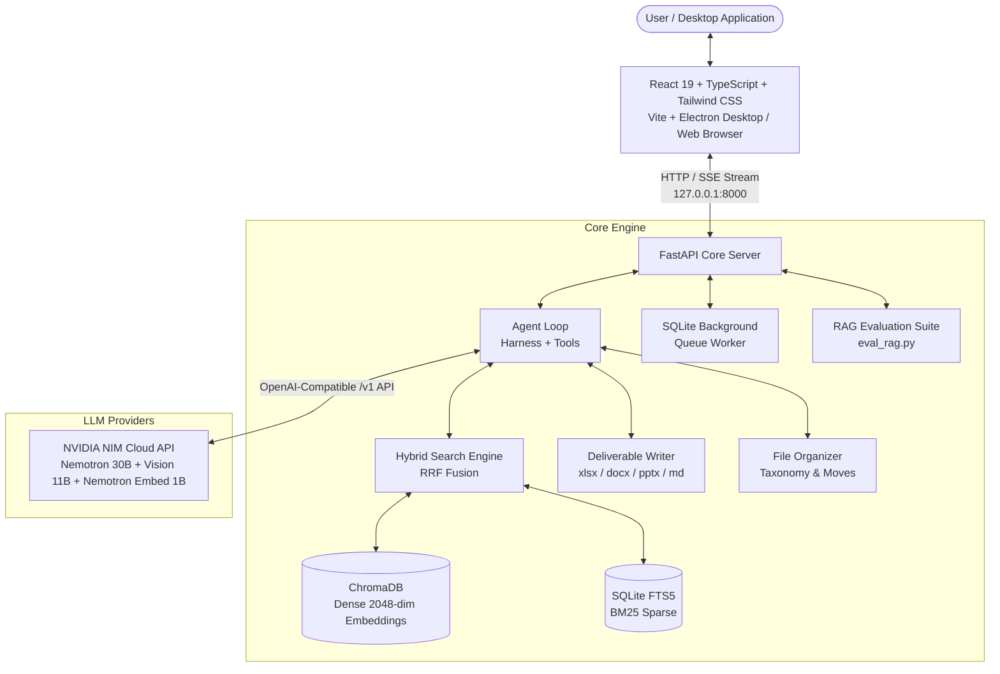

# Ada

> **A fast, local-first document intelligence agent and desktop assistant.**  
> Grounded question answering, hybrid RAG over real-world business formats, automated file organization, and real deliverable generation — powered by high-throughput NVIDIA NIM models.

---

## What is Ada?

Imagine having a research analyst on your desktop who has read every PDF, spreadsheet, presentation, document, and code file in your work folders. 

You can ask Ada questions in natural language, request audits, extract hard-to-find metrics, reorganize messy directories, or generate formatted Excel sheets, Word reports, and slide decks. 

Ada connects directly to high-throughput NVIDIA NIM models via the official NVIDIA API, with code-level citation verification ensuring that every single claim is backed by real page-level evidence.

---

## Key Features

- **High-Performance NVIDIA NIM Intelligence**  
  Powered directly by NVIDIA NIM endpoints (`nvidia/nemotron-3.5-lightning-30b-a3b` for fast reasoning and tool calling, `nvidia/nemotron-3-embed-1b` for dense retrieval embeddings, and `meta/llama-3.2-11b-vision-instruct` for multimodal OCR). Zero local GPU memory strain.

- **Hallucination-Proof Grounding & Citation Verification**  
  Every answer links back to exact files and page numbers (`[document.pdf:p.4]`). Claims, numbers, and physical units are deterministically validated in code against tool outputs — ungrounded citations and hallucinated figures are caught before reaching the user.

- **Hybrid Search (Dense Vectors + BM25 via RRF)**  
  Pure vector search fails silently on exact part numbers, SKU codes, and monetary figures (e.g., confusing `DWG-11483` with `DWG-11482`). Ada fuses dense embeddings (ChromaDB) with sparse keyword search (SQLite FTS5) using **Reciprocal Rank Fusion (RRF)**.

- **Multi-Format Business Ingestion**  
  Understands complex real-world files:
  - **PDFs**: Fast rendering and layout extraction via `pypdfium2` (permissive BSD-3 licensing).
  - **Spreadsheets (`.xlsx`, `.csv`, `.tsv`)**: Emits schema summaries and row-group chunks so queries hit specific rows rather than full-sheet data dumps.
  - **Presentations & Docs (`.pptx`, `.docx`)**: Extracts structured sections and bullet hierarchies.
  - **Images & Code**: Visual OCR cascade and multi-language syntax chunking.

- **Resilient 2-Hop Agent Loop**  
  Streams thoughts, tool calls, and tokens in real time over Server-Sent Events (SSE). Uses an 8-tool set designed for high accuracy with a "reconnaissance first, deep read second" strategy. Tools return actionable guidance so the model self-corrects.

- **Live Deliverable Generation**  
  Can directly produce real, openable files in your output directory:
  - **Excel Workbooks** (`.xlsx`) with typed columns and formatted numbers.
  - **Word Documents** (`.docx`) with structured headings and tables.
  - **PowerPoint Presentations** (`.pptx`) with slides and bullet points.
  - **Markdown Documents** (`.md`).

- **Universal Multi-Format File Organizer**  
  Inspects messy directories, classifies loose files across **all formats** (PDFs, Office documents, spreadsheets, presentations, images, audio, video, archives, code, and other formats), and presents non-destructive move suggestions for explicit review before applying.

- **Modern Desktop Frontend (React 19 + TypeScript + Electron + Vite)**  
  Full-featured desktop application with real-time SSE chat streaming, direct **document & PDF upload from the chat input or documents panel**, multi-format file organizer, and interactive RAG evaluation dashboard.

- **Dynamic RAG Evaluation Benchmark (Zero Dummy Data)**  
  Evaluates the 4 core pillars of retrieval-augmented generation (Retrieval Accuracy, Answer Correctness, Faithfulness, and Latency) using **questions extracted dynamically from your actual uploaded PDFs**, ensuring benchmark results reflect your real production documents.

---

## Architecture Overview



---

## Quick Start

### 1. Prerequisites

1. **Python 3.11+** installed.
2. **Node.js 18+** & **npm** installed.
3. An **NVIDIA API Key** (obtain free credits from [build.nvidia.com](https://build.nvidia.com)).

### 2. Configure Environment (`.env`)

Set your NVIDIA API key in `.env` (and `backend/.env`):
```env
NVIDIA_API_KEY=nvapi-your-key-here
NVIDIA_BASE_URL=https://integrate.api.nvidia.com/v1

CHAT_MODEL=nvidia/nemotron-3.5-lightning-30b-a3b
VISION_MODEL=meta/llama-3.2-11b-vision-instruct
EMBED_MODEL=nvidia/nemotron-3-embed-1b

REQUEST_TIMEOUT_SECONDS=120
REQUEST_MAX_RETRIES=2
EMBED_BATCH=64
```

### 3. Start the Backend

In your first terminal:
```bash
# Navigate to backend directory
cd backend

# Create & activate a virtual environment
python -m venv venv
# Windows:
.\venv\Scripts\activate
# macOS/Linux:
source venv/bin/activate

# Install dependencies
pip install -r requirements.txt

# Launch FastAPI backend
uvicorn server:app --host 127.0.0.1 --port 8000 --reload
```

### 4. Start the Frontend

In your second terminal:
```bash
# Navigate to frontend directory
cd frontend

# Install Node dependencies
npm install

# Option A: Run Vite + Electron desktop app (Recommended)
npm run dev

# Option B: Run Vite web browser dev server only
npx vite
```
Open the launched Electron application window, or navigate to **`http://localhost:5173`** in your web browser.

---

## Supported File Formats

| Format | Extensions | Ingestion Method |
|---|---|---|
| **PDF Documents** | `.pdf` | Multi-page text & layout extraction via `pypdfium2` |
| **Spreadsheets** | `.xlsx`, `.csv`, `.tsv` | Schema summaries + grouped row-level chunking via `openpyxl` |
| **Word Documents** | `.docx` | Paragraphs, tables, and heading structure via `python-docx` |
| **Presentations** | `.pptx` | Slide titles, text frames, and table extraction via `python-pptx` |
| **Images** | `.png`, `.jpg`, `.jpeg`, `.webp` | OCR cascade via vision model / `Pillow` |
| **Code & Text** | `.py`, `.ts`, `.js`, `.json`, `.md`, `.txt`, `.sql`, `.yaml` | Deterministic line & AST chunking |

---

## Testing & Verification

Ada includes automated smoke tests, agent behavioural benchmarks, and a comprehensive RAG evaluation suite:

```bash
cd backend

# 1. Full pipeline self-check (deterministic checks, parsing, tools)
python test_smoke.py

# 2. Golden agent benchmark (grounding, abstention, and deliverable creation)
python eval_agent.py

# 3. Comprehensive RAG evaluation suite (retrieval accuracy, correctness, faithfulness, latency)
python eval_rag.py
```

### Dynamic RAG Evaluation Benchmark (`eval_rag.py`)

Ada generates benchmark questions **dynamically from your uploaded PDFs** (zero dummy data or hardcoded mock files) and rigorously evaluates the 4 core pillars of retrieval-augmented generation:

| Pillar | Measured Metrics | Target Standard |
|---|---|---|
| **1. Retrieval Accuracy** | Hit Rate @ 1, 3, 5, Mean Reciprocal Rank (MRR), Precision @ 3, Recall @ 3 | Verifies exact part numbers, specs, and procedures surface in top hits. |
| **2. Answer Correctness** | Key Fact Recall, Token F1 Score, Out-of-corpus Abstention Fidelity | Ensures ground-truth facts are captured and unanswerable queries cleanly abstain without fabricating. |
| **3. Faithfulness & Groundedness** | Supported Claims %, Hallucination Rate %, Unsupported Numerical Figure Detection | Validates that all factual claims and numbers (e.g. `150 PSI`, `5400 RPM`) trace directly to retrieved chunks. |
| **4. Response Time (Latency)** | Mean, Median (P50), P90, P95, Min/Max (Retrieval vs. Generation) | Full latency profiling to identify retrieval bottlenecks and token generation throughput. |

#### CLI Options
```bash
# Run benchmark on all indexed uploaded PDFs
python eval_rag.py

# Evaluate a specific uploaded PDF
python eval_rag.py --pdf uploads/my_manual.pdf

# Run in offline deterministic mode (isolated SQLite + ChromaDB index)
python eval_rag.py --offline --pdf uploads/my_manual.pdf
```

#### API Endpoints
The evaluation suite can also be invoked or inspected via HTTP:
- `GET /eval/rag`: Returns the latest evaluation results JSON for uploaded PDFs.
- `POST /eval/rag`: Triggers a fresh benchmark execution on indexed PDFs.
- `POST /eval/rag/upload`: Uploads a PDF file, indexes it, and immediately evaluates RAG on it.

---

## License

Distributed under the MIT License. See [`LICENSE`](LICENSE) for more information.
