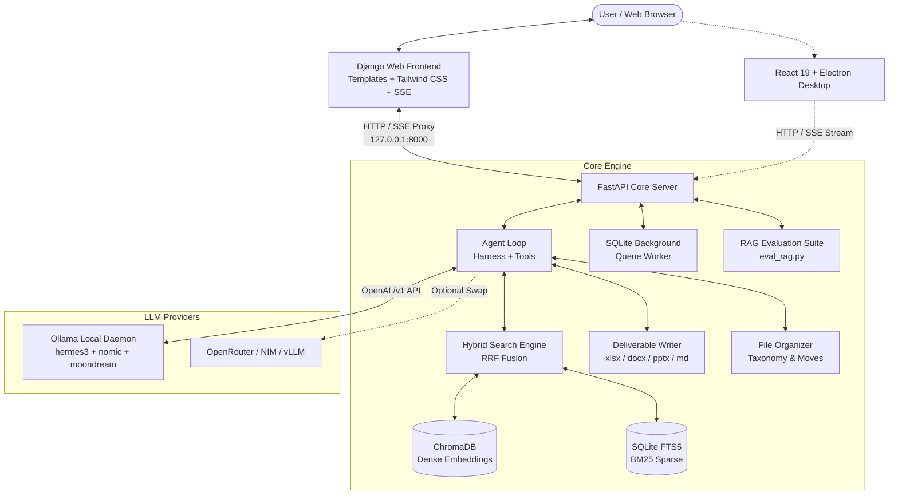

#  Ada

> **A fast, local-first document intelligence agent and desktop assistant.**  
> Grounded question answering, hybrid RAG over real-world business formats, automated file organization, and real deliverable generation — running 100% on your machine.

---

##  What is Ada in 30 Seconds?

Imagine having a research analyst on your desktop who has read every PDF, spreadsheet, presentation, document, and code file in your work folders. 

You can ask Ada questions in natural language, request audits, extract hard-to-find metrics, reorganize messy directories, or generate formatted Excel sheets, Word reports, and slide decks. 

**No data ever leaves your computer.** Ada runs against local Ollama models by default, with code-level citation verification ensuring that every single claim is backed by real page-level evidence.

---

##  Key Features

-  **100% Local & Privacy-First**  
  Zero cloud dependencies required. Runs locally with Ollama (`hermes3:latest` for chat/tools, `nomic-embed-text` for embeddings, and `moondream` for vision) or seamlessly swaps to hosted OpenAI-compatible endpoints (OpenRouter, NVIDIA NIM, vLLM).

-  **Hallucination-Proof Grounding & Citation Verification**  
  Every answer links back to exact files and page numbers (`[document.pdf:p.4]`). Claims, numbers, and physical units are deterministically validated in code against tool outputs — ungrounded citations and hallucinated figures are caught before reaching the user.

-  **Hybrid Search (Dense Vectors + BM25 via RRF)**  
  Pure vector search fails silently on exact part numbers, SKU codes, and monetary figures (e.g., confusing `DWG-11483` with `DWG-11482`). Ada fuses dense embeddings (ChromaDB) with sparse keyword search (SQLite FTS5) using **Reciprocal Rank Fusion (RRF)**.

-  **Multi-Format Business Ingestion**  
  Understands complex real-world files:
  - **PDFs**: Fast rendering and layout extraction via `pypdfium2` (permissive BSD-3 licensing).
  - **Spreadsheets (`.xlsx`, `.csv`, `.tsv`)**: Emits schema summaries and row-group chunks so queries hit specific rows rather than full-sheet data dumps.
  - **Presentations & Docs (`.pptx`, `.docx`)**: Extracts structured sections and bullet hierarchies.
  - **Images & Code**: Visual OCR cascade and multi-language syntax chunking.

-  **Resilient 2-Hop Agent Loop**  
  Streams thoughts, tool calls, and tokens in real time over Server-Sent Events (SSE). Uses an 8-tool set designed for 8B models with a "reconnaissance first, deep read second" strategy. Tools never throw unhandled crashes — they return actionable guidance so the model self-corrects.

-  **Live Deliverable Generation**  
  Can directly produce real, openable files in your output directory:
  -  **Excel Workbooks** (`.xlsx`) with typed columns and formatted numbers.
  -  **Word Documents** (`.docx`) with structured headings and tables.
  -  **PowerPoint Presentations** (`.pptx`) with slides and bullet points.
  -  **Markdown Documents** (`.md`).

-  **Universal Multi-Format File Organizer**  
  Inspects messy directories, classifies loose files across **all formats** (PDFs, Office documents, spreadsheets, presentations, images, audio, video, archives, code, installers, and other formats), and presents non-destructive move suggestions for explicit review before applying.

-  **Modern Frontend Options **  
  Full-featured Django web application with real-time SSE chat streaming, direct **document & PDF file upload and deletion**, multi-format file organizer, and RAG evaluation dashboard — plus the React 19 + Electron desktop app.

-  **Dynamic RAG Evaluation Benchmark **  
  Evaluates the 4 core pillars of retrieval-augmented generation (Retrieval Accuracy, Answer Correctness, Faithfulness, and Latency) using **questions extracted dynamically from your actual uploaded PDFs**, ensuring benchmark results reflect your real production documents.

---

##  Architecture Overview



---

##  Quick Start

### 1. Prerequisites

Make sure you have **Python 3.11+**, and **[Ollama](https://ollama.com)** installed. (Node.js is optional, only needed if using Electron).

Pull the default recommended local models:
```bash
ollama pull hermes3
ollama pull nomic-embed-text
ollama pull moondream
```

### 2. Start the Backend

```bash
# Navigate to backend directory
cd backend

# Create & activate a virtual environment
python -m venv venv
# Windows:
.\venv\Scripts\activate
# macOS/Linux:
source venv/bin/activate

# Install dependencies
pip install -r requirements.txt

# Launch FastAPI backend
uvicorn server:app --host 127.0.0.1 --port 8000 --reload
```

### 3. Start the Frontend

#### Option A: Django Web Frontend (Recommended Python Stack)

In a new terminal:
```bash
# Navigate to Django frontend directory
cd django_frontend

# Run initial migrations
python manage.py migrate

# Launch Django development server
python manage.py runserver 8080
```
Open **`http://127.0.0.1:8080`** in your browser to access the full Ada interface!

#### Option B: React + Electron Desktop App

In a new terminal:
```bash
# Navigate to frontend directory
cd frontend

# Install Node dependencies
npm install

# Run Vite + Electron in development mode
npm run dev
```

---

##  Configuration (`.env`)

Ada requires zero configuration to run locally with Ollama. If you want to customize models or use cloud providers, create a `.env` file in `backend/`:

```env
# --- Local Ollama Defaults ---
OLLAMA_HOST=127.0.0.1:11434
CHAT_MODEL=hermes3:latest
EMBED_MODEL=nomic-embed-text
VISION_MODEL=moondream

# --- Optional: Hosted Providers (OpenRouter / NVIDIA NIM / vLLM) ---
# CHAT_BASE_URL=https://openrouter.ai/api/v1
# CHAT_API_KEY=your-openrouter-key
# CHAT_MODEL=meta-llama/llama-3.1-70b-instruct

# --- System Tuning ---
CHAT_NUM_CTX=8192
EMBED_BATCH=64
```

---

##  Supported File Formats

| Format | Extensions | Ingestion Method |
|---|---|---|
| **PDF Documents** | `.pdf` | Multi-page text & layout extraction via `pypdfium2` |
| **Spreadsheets** | `.xlsx`, `.csv`, `.tsv` | Schema summaries + grouped row-level chunking via `openpyxl` |
| **Word Documents** | `.docx` | Paragraphs, tables, and heading structure via `python-docx` |
| **Presentations** | `.pptx` | Slide titles, text frames, and table extraction via `python-pptx` |
| **Images** | `.png`, `.jpg`, `.jpeg`, `.webp` | OCR cascade via vision model / `Pillow` |
| **Code & Text** | `.py`, `.ts`, `.js`, `.json`, `.md`, `.txt`, `.sql`, `.yaml` | Deterministic line & AST chunking |

---

##  Key Engineering Decisions

1. **Explicit `127.0.0.1` Binding**  
   On Windows, `localhost` attempts IPv6 (`::1`) first before timing out to IPv4. Ollama binds IPv4 only, causing a ~2.0-second SYN retry penalty on every single request. Pinning `127.0.0.1` dropped roundtrip latency from 2030ms to 0.8ms.
2. **Context-Optimized Local VRAM (`num_ctx`)**  
   Ollama reserves KV cache memory based on a model's theoretical max context (up to 262k), which pushes model layers onto the CPU on modest 6GB–8GB GPUs. Ada derives an optimized runtime model (`hermes3-ada`) capped at 8,192 tokens, increasing GPU residency from 29% to 71%.
3. **Resumable SQLite Indexing Queue**  
   Folder scanning queues work asynchronously in SQLite and reports progress in real time, preventing UI freezes even when ingesting thousands of enterprise files.
4. **Completely Permissive Licensing**  
   All dependencies use MIT, BSD, or Apache licenses (e.g., `pypdfium2` replaces `pymupdf` to eliminate AGPL copyleft restrictions).

---

##  Testing & Verification

Ada includes automated smoke tests, agent behavioural benchmarks, and a comprehensive RAG evaluation suite:

```bash
cd backend

# 1. Full pipeline self-check (deterministic checks, parsing, tools)
python test_smoke.py

# 2. Golden agent benchmark (grounding, abstention, and deliverable creation)
python eval_agent.py

# 3. Comprehensive RAG evaluation suite (retrieval accuracy, correctness, faithfulness, latency)
python eval_rag.py
```

### Dynamic RAG Evaluation Benchmark (`eval_rag.py`)

Ada generates benchmark questions **dynamically from your uploaded PDFs** (zero dummy data or hardcoded mock files) and rigorously evaluates the 4 core pillars of retrieval-augmented generation:

| Pillar | Measured Metrics | Target Standard |
|---|---|---|
| **1. Retrieval Accuracy** | Hit Rate @ 1, 3, 5, Mean Reciprocal Rank (MRR), Precision @ 3, Recall @ 3 | Verifies exact part numbers, specs, and procedures surface in top hits. |
| **2. Answer Correctness** | Key Fact Recall, Token F1 Score, Out-of-corpus Abstention Fidelity | Ensures ground-truth facts are captured and unanswerable queries cleanly abstain without fabricating. |
| **3. Faithfulness & Groundedness** | Supported Claims %, Hallucination Rate %, Unsupported Numerical Figure Detection | Validates that all factual claims and numbers (e.g. `150 PSI`, `5400 RPM`) trace directly to retrieved chunks. |
| **4. Response Time (Latency)** | Mean, Median (P50), P90, P95, Min/Max (Retrieval vs. Generation) | Full latency profiling to identify retrieval bottlenecks and token generation throughput. |

#### CLI Options
```bash
# Run benchmark on all indexed uploaded PDFs
python eval_rag.py

# Evaluate a specific uploaded PDF
python eval_rag.py --pdf uploads/my_manual.pdf

# Run in offline deterministic mode (isolated SQLite + ChromaDB index)
python eval_rag.py --offline --pdf uploads/my_manual.pdf
```

#### API Endpoints
The evaluation suite can also be invoked or inspected via HTTP:
- `GET /eval/rag`: Returns the latest evaluation results JSON for uploaded PDFs.
- `POST /eval/rag`: Triggers a fresh benchmark execution on indexed PDFs.
- `POST /eval/rag/upload`: Uploads a PDF file, indexes it, and immediately evaluates RAG on it.

---

##  License

Distributed under the MIT License. See `LICENSE` for more information.
