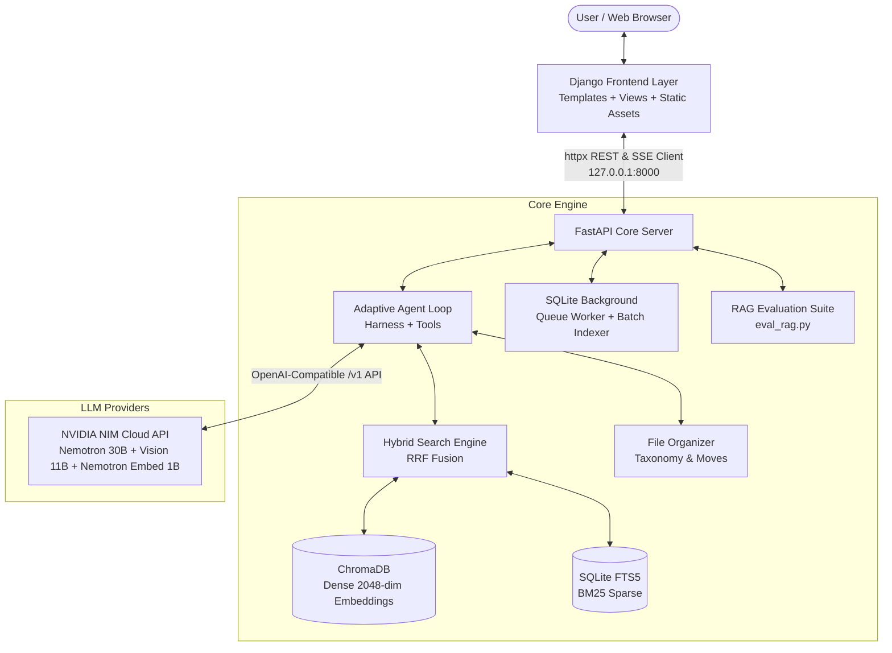

# Ada

> **A fast, local-first document intelligence agent and desktop assistant.**  
> Grounded question answering, hybrid RAG over real-world business formats, adaptive multi-hop reasoning, automated file organization, and real deliverable generation — powered by high-throughput NVIDIA NIM models with a Python Django frontend.

---

## What is Ada?

Imagine having an expert research analyst on your desktop who has read every PDF, spreadsheet, presentation, document, and code file in your work folders. 

You can ask Ada questions in natural language, attach documents on the fly via paperclip or drag-and-drop, inspect complex multi-page evidence, reorganize messy directories, or perform deep document synthesis. 

Ada connects directly to high-throughput NVIDIA NIM models via the official NVIDIA API, with code-level citation verification ensuring that every single claim is backed by real page-level evidence.

---

## Key Features

- **High-Performance NVIDIA NIM Intelligence**  
  Powered directly by NVIDIA NIM endpoints (`nvidia/nemotron-3.5-lightning-30b-a3b` for fast reasoning and tool calling, `nvidia/nemotron-3-embed-1b` for dense retrieval embeddings, and `meta/llama-3.2-11b-vision-instruct` for multimodal OCR). Zero local GPU memory strain.

- **Adaptive Multi-Step Agent Execution**  
  Unlike naive agents that quit after a few tool steps, Ada dynamically verifies whether sufficient evidence has been collected:
  - Higher step budgets (`AGENT_MAX_STEPS=25`, `AGENT_WALL_CLOCK_SECONDS=600`, configurable via `.env`).
  - Multi-passage batch reading (`read_chunks`) inspecting up to 8 passages simultaneously.
  - Repeated-tool feedback loop guiding the agent to reformulate queries when search results repeat.
  - Fallback synthesis ensuring thorough, well-structured final answers with headings, bullet points, and citations.

- **Direct File Attachments & Drag-and-Drop**  
  Attach PDFs, Word documents, Excel workbooks, code files, and presentations directly in the chat interface via the paperclip button or drag-and-drop overlay. Attached files are indexed synchronously and injected into agent context (`<attached_documents>`) for immediate document-focused reasoning.

- **Memory-Safe Large PDF & Document Ingestion**  
  Processes massive PDFs (100MB+, hundreds of pages) without memory exhaustion or process crashes:
  - Page-batch streaming (`PDF_PAGE_BATCH_SIZE=25`) releasing page text objects via `finally:` cleanup blocks.
  - Incremental chunk appending (`append_chunks`) to ChromaDB and SQLite FTS5.
  - Real-time progress tracking with honest page and chunk metrics.

- **Hallucination-Proof Grounding & Citation Verification**  
  Every answer links back to exact files and page numbers (`[document.pdf:p.4]`). Claims, numbers, and physical units are deterministically validated in code against tool outputs — ungrounded citations and hallucinated figures are caught before reaching the user.

- **Hybrid Search (Dense Vectors + BM25 via RRF)**  
  Pure vector search fails silently on exact part numbers, SKU codes, and monetary figures (e.g., confusing `DWG-11483` with `DWG-11482`). Ada fuses dense embeddings (ChromaDB) with sparse keyword search (SQLite FTS5) using **Reciprocal Rank Fusion (RRF)**, with optional filename-level scoping.

- **Multi-Format Business Ingestion**  
  Understands complex real-world files:
  - **PDFs**: Fast rendering and layout extraction via `pypdfium2` (permissive BSD-3 licensing).
  - **Spreadsheets (`.xlsx`, `.csv`, `.tsv`)**: Emits schema summaries and row-group chunks so queries hit specific rows rather than full-sheet data dumps.
  - **Presentations & Docs (`.pptx`, `.docx`)**: Extracts structured sections and bullet hierarchies.
  - **Images & Code**: Visual OCR cascade and multi-language syntax chunking.

- **Universal Multi-Format File Organizer**  
  Inspects messy directories, classifies loose files across **all formats** (PDFs, Office documents, spreadsheets, presentations, images, audio, video, archives, code), and presents non-destructive move suggestions for explicit review before applying.

- **Python Django Frontend & Modern Responsive Web UI**  
  Built with a clean Python Django architecture (HTML5, modern CSS3, responsive dark purple theme, modular vanilla JavaScript). Features real-time SSE chat streaming, document attachment previews, file reorganization, and clean UI without clutter.

- **Dynamic RAG Evaluation Benchmark (Zero Dummy Data)**  
  Evaluates the 4 core pillars of retrieval-augmented generation (Retrieval Accuracy, Answer Correctness, Faithfulness, and Latency) using **questions extracted dynamically from your actual uploaded PDFs**, ensuring benchmark results reflect your real production documents.

---

## Architecture Overview



---

## Quick Start

### 1. Prerequisites

1. **Python 3.11+** installed.
2. An **NVIDIA API Key** (obtain free credits from [build.nvidia.com](https://build.nvidia.com)).

### 2. Install Dependencies

Install all Python dependencies for both backend and Django frontend:
```bash
pip install -r requirements.txt
```

Initialize the Django database tables:
```bash
python django_frontend/manage.py migrate
```

### 3. Configure Environment (`.env`)

Set your NVIDIA API key and tuning parameters in `.env`:
```env
NVIDIA_API_KEY=nvapi-your-key-here
NVIDIA_BASE_URL=https://integrate.api.nvidia.com/v1

CHAT_MODEL=nvidia/nemotron-3.5-lightning-30b-a3b
VISION_MODEL=meta/llama-3.2-11b-vision-instruct
EMBED_MODEL=nvidia/nemotron-3-embed-1b

# Adaptive Agent Limits
AGENT_MAX_STEPS=25
AGENT_WALL_CLOCK_SECONDS=600
AGENT_MAX_TOOL_CALLS=35
AGENT_MAX_REPAIRS=3

# Large PDF & Ingestion
MAX_UPLOAD_BYTES=150000000
PDF_PAGE_BATCH_SIZE=25
CHUNK_SIZE=1000
CHUNK_OVERLAP=150
EMBED_BATCH_SIZE=32

# Django to FastAPI bridge
FASTAPI_BASE_URL=http://127.0.0.1:8000
```

---

## Running the Application

### Option A: One-Command Unified Launcher (Recommended)

Run the unified startup script:
```bash
# Starts FastAPI + Django and automatically opens your web browser
python run_app.py
```

Command-line flags:
- `python run_app.py`: Starts both services and opens your default browser at `http://127.0.0.1:8080`.
- `python run_app.py --no-browser`: Runs services in headless/background mode without opening a browser window.

### Option B: Independent Service Execution (For Development)

You can run each service independently in separate terminals:

**Terminal 1 — FastAPI Backend (Port 8000):**
```bash
cd backend
uvicorn server:app --host 127.0.0.1 --port 8000 --reload
```

**Terminal 2 — Django Frontend (Port 8080):**
```bash
cd django_frontend
python manage.py runserver 127.0.0.1:8080
```

---

## Testing & Verification

Ada includes automated smoke tests, Django frontend test suite, agent behavioural benchmarks, and a comprehensive RAG evaluation suite:

```bash
# 1. Django Frontend Unit & View Integration Tests
python django_frontend/manage.py test ada_app

# 2. Comprehensive enhancements unit tests
python backend/test_audit_enhancements.py

# 3. Backend pipeline smoke tests (deterministic checks, parsing, tools)
python backend/test_smoke.py

# 4. Golden agent benchmark (grounding, abstention, and multi-passage retrieval)
python backend/eval_agent.py

# 5. Comprehensive RAG evaluation suite (retrieval accuracy, correctness, faithfulness, latency)
python backend/eval_rag.py
```

---

## License

Distributed under the MIT License. See [`LICENSE`](LICENSE) for more information.
